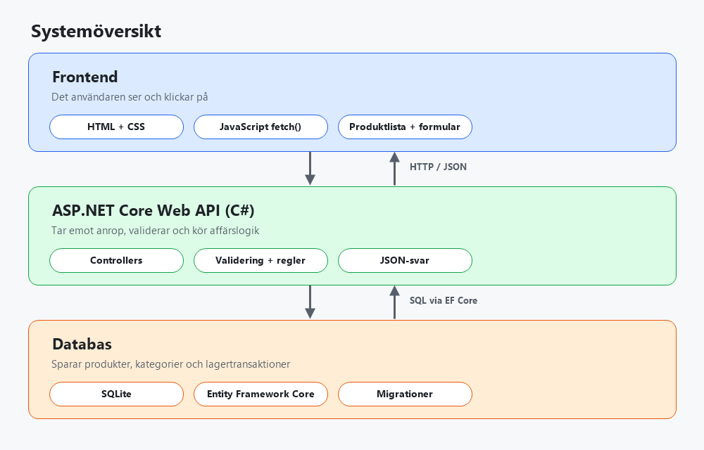
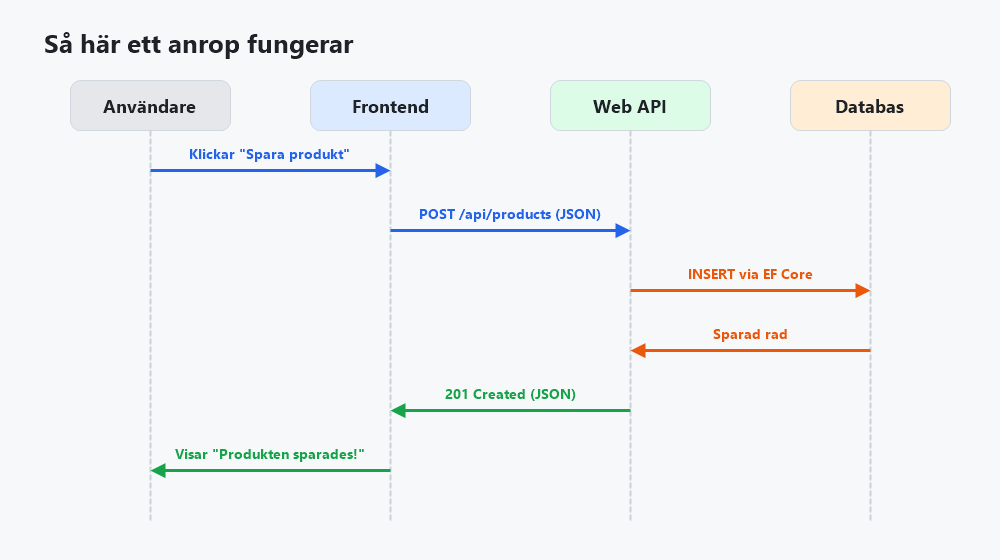
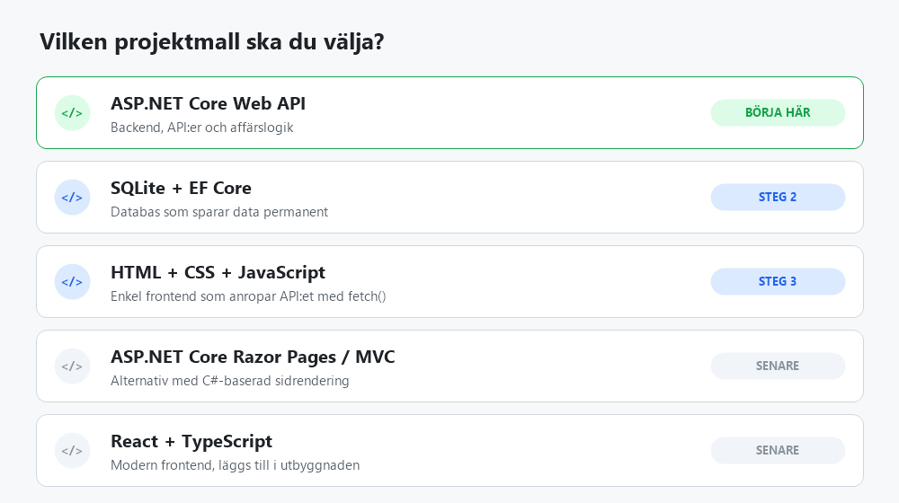
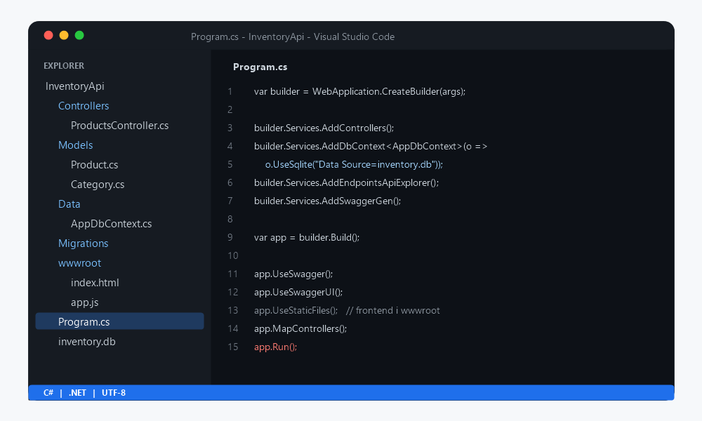
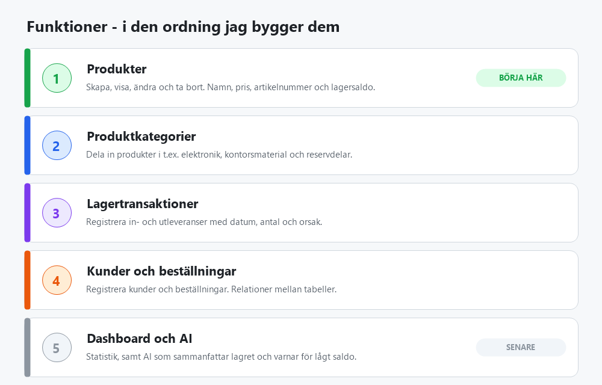

# Projekt-design – Lagerhanteringssystem (ERP)

Mitt första fullstack-projekt: ett enkelt lagersystem där man hanterar produkter, kategorier och lagersaldo.

## 1. Vad jag bygger

| Del | Roll |
|---|---|
| **Frontend** | Det användaren ser: produktlista, formulär och lagersaldo |
| **Backend (ASP.NET Core Web API)** | Tar emot anrop, validerar data och kör affärslogik |
| **Databas (SQLite + EF Core)** | Sparar produkter, kategorier och lagertransaktioner |

## 2. Begrepp

- **C#** – språket jag skriver logiken i.
- **.NET** – plattformen som kör C#-koden och ger verktyg och bibliotek.
- **ASP.NET Core** – ramverket för webbapplikationer och API:er.
- **API** – gränssnittet frontend använder för att prata med backend.
- **Databas** – lagrar informationen permanent.

## 3. Så flödar data

Användaren gör något i frontend → frontend skickar en HTTP-förfrågan (URL) till API:et → API:et frågar databasen → svaret skickas tillbaka som JSON och visas för användaren.

## 4. Val av projektmall

Jag börjar med **ASP.NET Core Web API** i Visual Studio Code. React + TypeScript kan läggas till senare.

När projektet är skapat startar allt i `Program.cs`:

## 5. Funktioner i den ordning jag bygger dem

1. **Produkter** – skapa, visa, ändra och ta bort (namn, pris, artikelnummer, lagersaldo).
2. **Produktkategorier** – t.ex. elektronik, kontorsmaterial, reservdelar.
3. **Lagertransaktioner** – in- och utleveranser med datum, antal och orsak.
4. **Kunder och beställningar** – relationer mellan flera tabeller.
5. **Dashboard och AI** – statistik och senare en AI-funktion som sammanfattar lagret eller varnar för lågt saldo.

## 6. Teknikval

| Område | Val |
|---|---|
| Språk | C# |
| Backend | ASP.NET Core Web API |
| Databas | SQLite via Entity Framework Core |
| Frontend | HTML, CSS, JavaScript (`fetch`), senare React + TypeScript |
| Verktyg | Visual Studio Code, Git/GitHub |

Se även [Step-by-step](../Step-by-step/Plan.md) för arbetsordningen.
