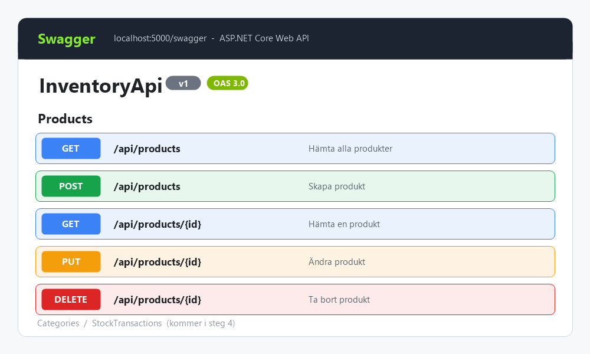
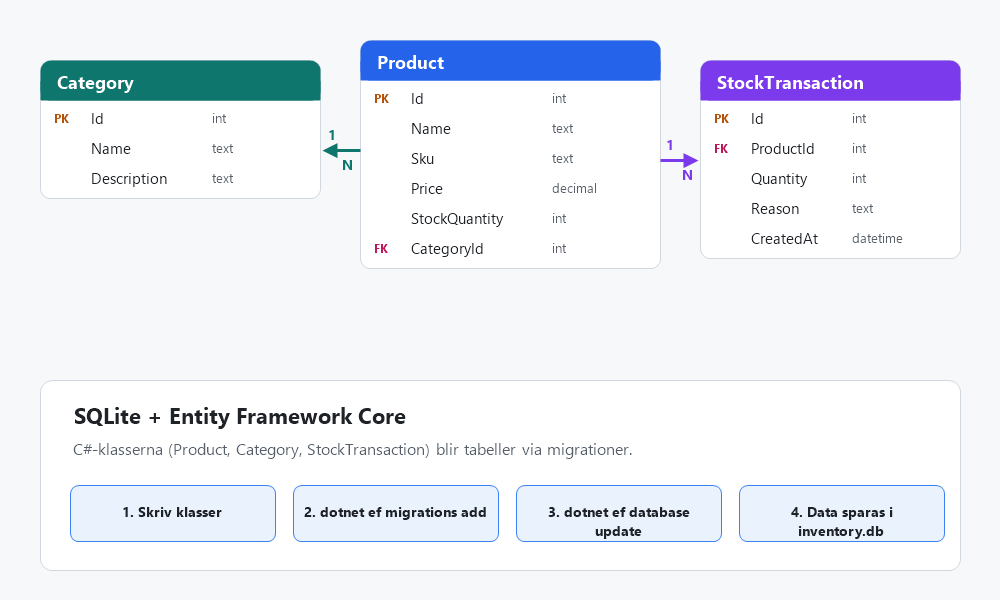
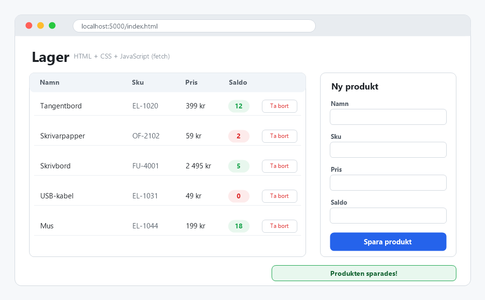
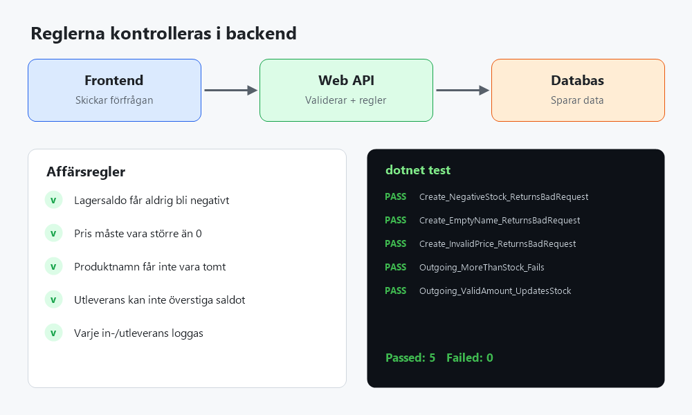
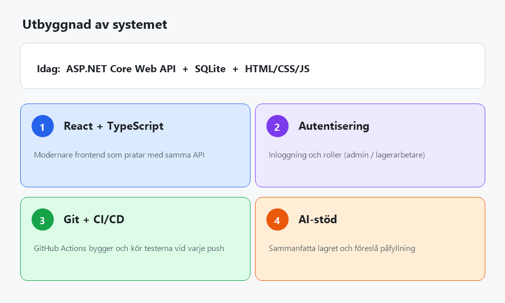

# Step-by-step – från noll till fullstack

Fem steg. Gå vidare först när du kan förklara "Mål"-raden i steget.

| Steg | Fokus | Klart när du kan… |
|---|---|---|
| [1](#steg-1--backend-och-api) | Backend och API | förklara endpoints och HTTP |
| [2](#steg-2--databas) | Databas | skilja minne från databas |
| [3](#steg-3--frontend) | Frontend | lägga till en produkt i gränssnittet |
| [4](#steg-4--riktig-affärslogik) | Affärslogik | motivera backend-validering |
| [5](#steg-5--utbyggnad) | Utbyggnad | bygga vidare med React, auth, CI/CD, AI |

---

## Steg 1 – Backend och API

- [ ] Skapa ett ASP.NET Core Web API.
- [ ] Förstå `Program.cs`, klasser, metoder och objekt.
- [ ] Skapa en `Product`-klass.
- [ ] Bygg en endpoint för att hämta produkter (`GET`).
- [ ] Lägg till skapa (`POST`), ändra (`PUT`) och ta bort (`DELETE`).

**Mål:** förklara vad en endpoint är och hur en HTTP-förfrågan hanteras.

---

## Steg 2 – Databas

- [ ] Lär dig grunderna i SQL.
- [ ] Skapa en SQLite-databas.
- [ ] Koppla in Entity Framework Core.
- [ ] Spara produkter permanent.
- [ ] Lär dig vad en migration är.

**Mål:** förklara skillnaden mellan data i en lista i minnet och data som sparas i databasen.

---

## Steg 3 – Frontend

- [ ] Skapa en sida med HTML och CSS.
- [ ] Visa produkter i en tabell.
- [ ] Hämta data från API:et med `fetch()`.
- [ ] Skapa ett formulär för nya produkter.
- [ ] Visa felmeddelanden och bekräftelser.

**Mål:** lägga till en produkt i gränssnittet och se den sparad i databasen.

---

## Steg 4 – Riktig affärslogik

- [ ] Hindra negativa lagersaldon.
- [ ] Validera priser och produktnamn.
- [ ] Registrera in- och utleveranser.
- [ ] Lägg till kategorier och sökning.
- [ ] Skriv automatiserade tester.

**Mål:** förstå varför reglerna ska kontrolleras i backend och inte bara i frontend.

---

## Steg 5 – Utbyggnad

- [ ] Lär dig React och TypeScript (valfritt).
- [ ] Lägg till autentisering och användarroller.
- [ ] Träna på Git, tester och CI/CD.
- [ ] Integrera AI för att sammanfatta lagerdata eller hitta påfyllningsbehov.

**Mål:** ett komplett system som kan växa.

> Bilderna är illustrationer av din tekniska stack (ASP.NET Core Web API, SQLite + EF Core, HTML/CSS/JS, xUnit-tester, React/auth/CI/AI). Byt ut dem mot egna skärmdumpar när stegen är klara.

Se även [Projekt-design](../Projekt-design/Projekt-design.md).
